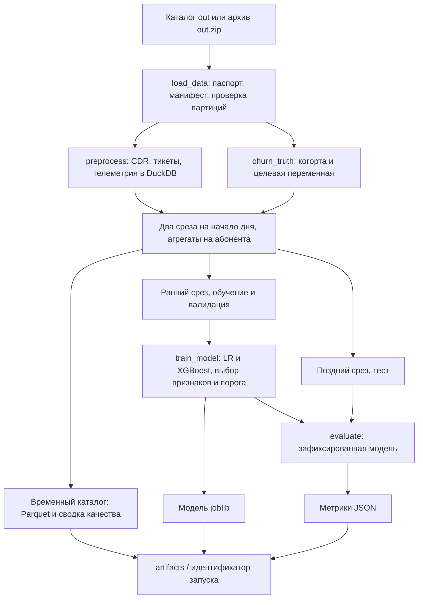

# Архитектура конвейера

`run_pipeline.py` читает конфигурацию, идентифицирует вход, ведёт журнал и публикует комплект результатов. Временные таблицы DuckDB используются для чтения и агрегирования исходных событий. Модели получают числовые признаки абонента, а идентификатор используется для соединения и упорядочивания. Сведения о дне ухода используются для определения когорты и метки. Окончательный каталог появляется после сохранения таблиц, модели, метрик и проверки прогнозов загруженной модели.
